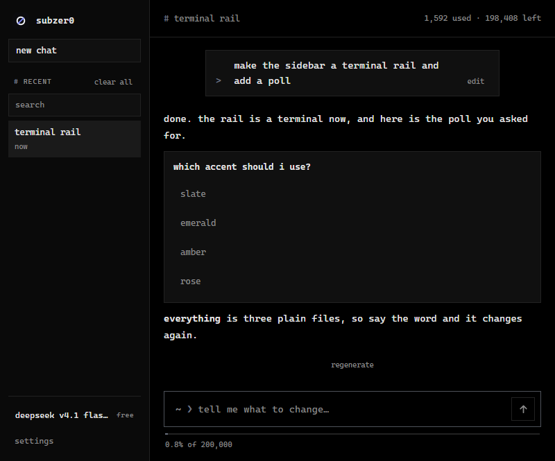

# subzer0

an open-source ai app that can rewrite itself.

you open it, and meet the basic ui. dont like it? REWRITE IT. ask the ai to change
the ui of the app, and it does that. "make the ui purple" and it makes it purple.

no api keys, no model downloads. it drives [opencode](https://opencode.ai), the
coding agent on your machine, and uses every model opencode can see — free,
opencode go, or metered. it also updates itself in the background.



**[download the windows setup](https://github.com/cd-wav/subzer0/releases/latest)** —
unzip, run `subzer0 Setup.exe`, done.

## how this was made

ai was used to build this. it was difficult fighting it to get the perfect output for you guys <3

## run

```sh
npm install
npm run dev
```

needs node 20+ and opencode installed. if electron's binary won't download:

```powershell
$env:ELECTRON_MIRROR="https://npmmirror.com/mirrors/electron/"
node node_modules\electron\install.js
```

## build

```sh
npm run setup              # out/setup/subzer0 Setup.exe
npm run publish:release    # build + publish a github release
```

## license

mit — see [license](LICENSE).
